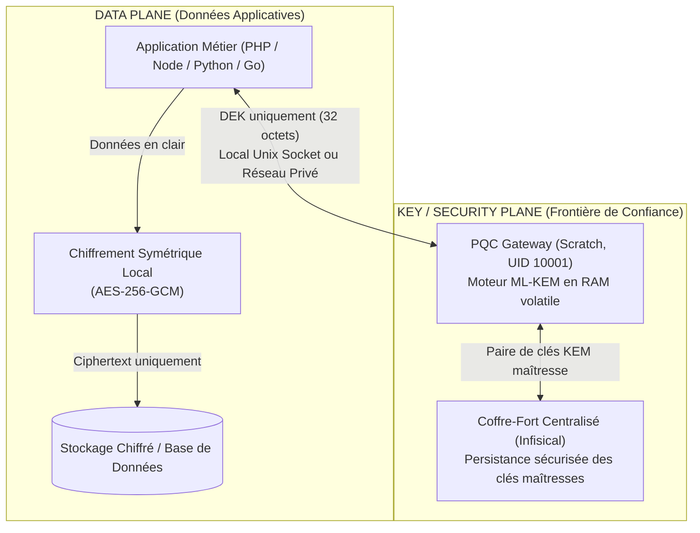
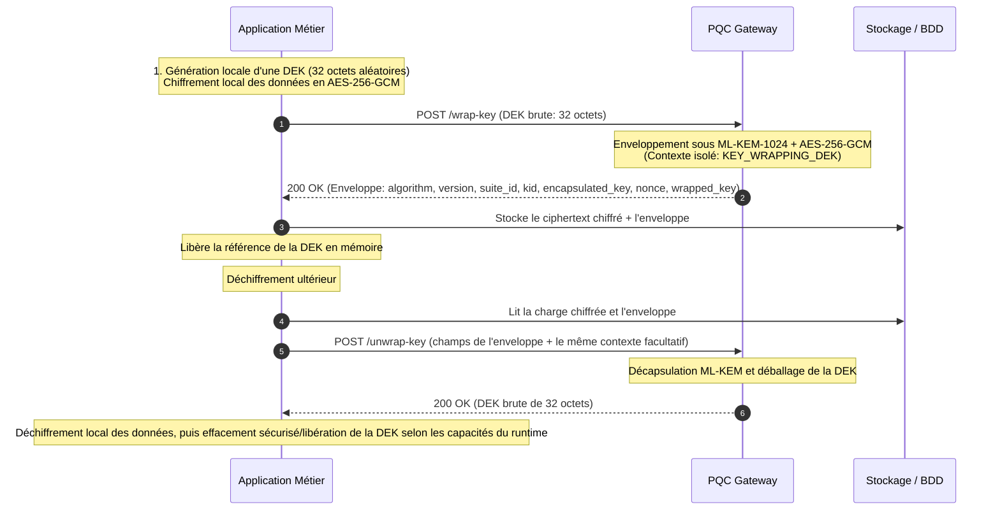

# Passerelle Cryptographique Post-Quantique (ML-KEM + AES-256-GCM)

[🇫🇷 Français](README.fr.md) | [🇬🇧 English](README.md)

Ce projet fournit une passerelle (gateway) autonome de chiffrement et d'encapsulation de clés post-quantique, implémentant l'algorithme **ML-KEM** tel que standardisé dans le **NIST FIPS 203**, et aligné avec les algorithmes retenus par les recommandations **NSA CNSA 2.0**.

> [!IMPORTANT]
> **Positionnement & Frontière de Confiance** :
> Ce composant est conçu exclusivement comme un service d'infrastructure interne destiné à opérer sur un **réseau privé, isolé et segmenté** (ou via socket Unix IPC local). Il n'a **pas vocation à être exposé directement sur Internet** sans couche d'authentification, d'autorisation et de filtrage réseau préalable.

---

## 1. Modèle de Sécurité et Frontières de Confiance (Trust Boundary)

Comprendre le périmètre de sécurité est fondamental avant tout déploiement :



### Principes Clés du Modèle de Menace :
1. **L'accès au Gateway constitue la frontière de confiance** : Tout processus capable de contacter le gateway peut demander l'opération `/unwrap-key`. Restreindre l'accès par les permissions du système de fichiers (socket Unix, `SOCKET_MODE` au plus `0770`, et `SOCKET_ALLOWED_UIDS` pour n'admettre que des UID attestés par le noyau), par **mTLS** (`TLS_CLIENT_CA_FILE` et `TLS_CLIENT_ALLOWED_NAMES` : un certificat client vérifié et nommé est alors exigé sur toutes les routes sauf `/health`) ou par **jetons porteurs** (`AUTH_TOKENS`).
   - **Transport fail-closed** : en production, le service refuse de démarrer sur une adresse TCP hors loopback sans TLS, sauf `ALLOW_INSECURE_TCP=true` posé explicitement. Hors conteneur, il écoute par défaut sur `127.0.0.1`.
2. **Architecture Sidecar recommandée (1 Gateway par SaaS/App)** : Déployer une instance du gateway dédiée par application ou tenant réduit le rayon d'impact entre consommateurs et empêche l'accès direct aux clés entre applications.
3. **Cas du Gateway partagé (Mutualisation)** : Si une instance unique est partagée entre plusieurs applications, authentifier les consommateurs (mTLS, jetons ou UID) et activer la **liaison d'identité** (`BIND_CLIENT_IDENTITY=true`, voir §6a) : l'identité du client entre dans la dérivation de clé de chaque enveloppe, qu'aucun autre client ne peut ouvrir. Le **contexte de chiffrement** (voir §4b) lie en plus l'enveloppe à un enregistrement.

---

## 2. Architecture Cryptographique Recommandée : Envelope Encryption (KMS Wrapping)

L'architecture principale recommandée pour protéger des bases de données, des fichiers volumineux et des sauvegardes est l'**Envelope Encryption** via `/wrap-key` et `/unwrap-key`.

### Pourquoi ce modèle est supérieur :
- **Zéro transit de données volumineuses** : Les fichiers de plusieurs mégaoctets ou gigaoctets ne transitent jamais vers le gateway. Seule la clé symétrique de 32 octets est échangée.
- **Performance maximale** : Le chiffrement des gros volumes s'effectue localement dans le processus applicatif (AES-256-GCM avec accélération matérielle AES lorsque disponible).
- **Gestion simplifiée des clés** : Les opérations de gestion de clés concernent principalement les enveloppes DEK compactes plutôt que les volumes de données en vrac. Le versioning et la rotation automatisée des clés maîtresses sont des capacités planifiées.
- **Guide Opérationnel** : Le chiffrement par enveloppe est recommandé pour les données volumineuses ou stockées durablement. Le chiffrement direct demeure un mode pris en charge de premier plan pour les charges utiles réduites et les architectures d'intégration simples.



---

## 3. Modes d'Opération du Gateway

| Endpoint | Rôle | Cas d'Usage | Recommandation |
| :--- | :--- | :--- | :--- |
| **`/wrap-key` & `/unwrap-key`** | **Envelope Encryption (KMS)** | Bases de données, fichiers, sauvegardes, archivage | ⭐ **Architecture Recommandée** |
| `/encrypt` & `/decrypt` | Chiffrement hybride direct | Messages et fichiers jusqu'à 10 Mio par défaut, payloads JSON | Usage d'appoint |
| `/kem/encapsulate` & `/kem/decapsulate` | Accord de clé pur | Établissement de secret partagé post-quantique | Protocoles personnalisés |
| `/generate-key` | Génération de clé DEK | Génération d'une nouvelle DEK + son enveloppe | Initialisation de session |
| `/public-key` | Distribution de clé KEM | Récupération de la clé publique active | Intégrations asymétriques |
| `/health` | Sonde de vitalité | Healthchecks Docker / orchestrateurs | Supervision |
| `/metrics` | Exposition texte Prometheus | Compteurs de requêtes, histogrammes de latence, rejets de débit et de saturation ; soumis à l'authentification (jeton, mTLS) comme les autres routes | Observabilité *(désactivable via `METRICS_ENABLED`)* |

---

## 4. Spécifications Cryptographiques et Alignements

| Algorithme | Standard de Référence | Clé Publique | Clé Privée (RAM) | Clé Encapsulée | Objectif de Sécurité |
| :--- | :--- | :--- | :--- | :--- | :--- |
| **ML-KEM-1024** *(défaut)* | NIST FIPS 203 | **1568 octets** | 3168 octets | **1568 octets** | Catégorie 5 NIST (Aligné recommandations CNSA 2.0) |
| **ML-KEM-768** | NIST FIPS 203 | 1184 octets | 2400 octets | 1088 octets | Catégorie 3 NIST |
| **DUAL-X25519+ML-KEM-1024** | Hybride classique + PQ | 1600 octets | 3200 octets | 1600 octets | Stratégie de défense en profondeur hybride / migration |
| **DUAL-X25519+ML-KEM-768** | Hybride classique + PQ | 1216 octets | 2432 octets | 1120 octets | Défense en profondeur hybride (Performance / Sécurité) |

- **Alignement CNSA 2.0** : Le service utilise des algorithmes sélectionnés et alignés avec les recommandations CNSA 2.0 pour l'établissement de clés (ML-KEM-1024) et le chiffrement symétrique (AES-256-GCM). *Note : une conformité CNSA 2.0 globale englobe d'autres protocoles et algorithmes (signature ML-DSA) non couverts par cette brique.*
- **Implémentation FIPS 203** : Le gateway implémente ML-KEM conformément aux spécifications du standard NIST FIPS 203 via la bibliothèque CIRCL (Cloudflare). *Il ne prétend pas faire l'objet d'une validation de module FIPS 140-3 / CMVP.*
- **Constructions Hybrides DUAL** : Les modes DUAL (`DUAL-X25519+ML-KEM-768` et `DUAL-X25519+ML-KEM-1024`) sont des constructions hybrides définies par le projet combinant X25519 et ML-KEM via HKDF-SHA256 avec liaison au transcript. Le composant ML-KEM est conforme au standard FIPS 203 ; la construction hybride globale n'est pas en elle-même un standard de KEM du NIST.
- **Gestion des Clés & Mode Éphémère vs Coffre** :
  - Lorsqu'un coffre est configuré (`KEYSTORE=infisical` ou `openbao`, voir §6c), la paire de clés active est chargée depuis le coffre ou stockée sous forme d'un bundle unique vérifié.
  - Lorsqu'il est désactivé, la passerelle fonctionne avec une paire éphémère en mémoire vive.
  - **Avertissement mode éphémère** : sans coffre (`KEYSTORE=none`), une nouvelle paire de clés KEM est générée à chaque démarrage du processus. Les ciphertexts et clés enveloppées générés avec une instance précédente ne peuvent être récupérés après un redémarrage, à moins que la paire de clés correspondante n'ait été conservée de manière externe.
- **Identifiant de clé et rotation** :
  - Chaque enveloppe porte un `kid` : `hex(SHA-256("pqc-kid:" ‖ clé publique))[:16]`, qui désigne la clé destinataire. Une enveloppe dont le `kid` désigne une autre clé est refusée (`422`). `/public-key` renvoie le `kid` actif.
  - Choisir parmi plusieurs clés privées conservées selon le `kid` (trousseau) est la prochaine étape de la feuille de route ; aujourd'hui le gateway sert la seule paire active.
- **Dérivation HKDF** : HKDF-SHA256 avec transcript canonique TLV (Tag-Length-Value) garantissant l'orthogonalité stricte entre les contextes d'usage.

---

## 4b. Format d'Enveloppe, Contexte de Chiffrement et Réponses

- **Enveloppe JSON** : `algorithm`, `version` et `suite_id` sont obligatoires en entrée ; `kid` est facultatif (les enveloppes produites par la 0.0.x n'en ont pas et restent déchiffrables).
- **Contexte de chiffrement** (équivalent de l'*encryption context* d'un KMS) : `/encrypt`, `/decrypt`, `/wrap-key`, `/unwrap-key` et `/generate-key` acceptent une chaîne facultative `"context"` (routes binaires : en-tête `X-Encryption-Context`, 4 Kio au plus). Elle est liée au sel HKDF et à l'AAD AES-GCM : il faut exactement le même contexte pour déchiffrer. Elle n'est **jamais renvoyée ni stockée** avec l'enveloppe : la reconstituer depuis vos données (locataire, identifiant d'enregistrement…). Échanger les enveloppes de deux enregistrements échoue alors en `422`.
- **Réponse de `/decrypt`** : un seul champ est renseigné — `plaintext` si le clair est de l'UTF-8 valide et que son encodage JSON reste proche de sa taille (au plus la taille Base64 + 4 Kio), `data` (Base64) sinon. Un client doit donc accepter les deux champs.
- **Tailles de corps par route** : `/encrypt` accepte `MAX_PAYLOAD_BYTES` ; `/decrypt` accepte `1,5 × MAX_PAYLOAD_BYTES + 64 Kio`, ce qui garantit que **tout chiffré produit par `/encrypt` est déchiffrable**, en JSON comme en binaire, même réencodé avec des `\/` (`json_encode` de PHP). Toutes les autres routes (clés, KEM, `GET`) sont limitées à 64 Kio. Un `Content-Length` supérieur à la limite est refusé (`413`) avant toute lecture.
- **Types de contenu** : un corps doit être déclaré `application/json` (ou `application/octet-stream` sur les routes binaires), sinon `415`. Un JSON envoyé en `text/plain` ou depuis un formulaire HTML n'est jamais traité.
- **JSON strict** : un seul objet par requête ; chaque clé doit correspondre exactement (casse comprise) à un champ documenté, une seule fois ; Base64 standard canonique (RFC 4648 avec remplissage) ; `/encrypt` exige exactement un des champs `plaintext` ou `data`. Les messages d'erreur ne citent jamais une valeur reçue.
- **Format binaire** (`application/octet-stream`), big-endian, émis en V3, V2 toujours accepté en lecture :

  ```text
  V3 : 'P' 'Q' 0x03 | suite_id (2) | kid (8) | len(encap) (2) | encap | nonce (12) | chiffré+tag
  V2 : 'P' 'Q' 0x02 | suite_id (2) |           len(encap) (2) | encap | nonce (12) | chiffré+tag
  ```

  Les enveloppes historiques sans en-tête et `ALLOW_LEGACY_ENVELOPES` ont été supprimées en 0.1.0.

---

## 5. Modes de Transport : Socket Unix vs Réseau Privé TCP

| Mode | Paramètres | Propriétés de Sécurité | Recommandation |
| :--- | :--- | :--- | :--- |
| **Socket IPC Unix (Mode TCP désactivé)** | `SOCKET_PATH=/tmp/pq-crypto/pq.sock`<br>`DISABLE_TCP=true`<br>`SOCKET_ALLOWED_UIDS=33` | **IPC local géré par le noyau Linux via un Unix Domain Socket dont le point d'entrée réside sur un volume tmpfs éphémère**. Élimine l'exposition au transport réseau sur l'hôte. | ⭐ **Recommandé pour déploiements colocalisés (Sidecar)** |
| **Mode Dual (TCP + Socket)** | `PORT=8080`<br>`SOCKET_PATH=/tmp/pq-crypto/pq.sock`<br>`DISABLE_TCP=false` | Permet une écoute concurrente locale et réseau privé. | Migration ou clients mixtes |
| **TCP avec mTLS** | `TLS_CERT_FILE`, `TLS_KEY_FILE`<br>`TLS_CLIENT_CA_FILE`<br>`TLS_CLIENT_ALLOWED_NAMES` | TLS 1.3 (échange de clé hybride X25519MLKEM768 en premier) et certificat client vérifié sur toutes les routes sauf `/health`, qui ne renvoie alors qu'un état minimal. Un certificat émis par une autre autorité échoue à la poignée de main ; un certificat de la bonne autorité dont aucun nom (CN, SAN DNS ou URI) n'est dans `TLS_CLIENT_ALLOWED_NAMES` reçoit `403`. | ⭐ **Déploiements multi-serveurs** |
| **TCP avec TLS seul** | `TLS_CERT_FILE`, `TLS_KEY_FILE` | Transport chiffré, sans authentification du client (conserver le filtrage réseau). | Réseaux privés avec authentification en amont |
| **TCP en clair** | `ALLOW_INSECURE_TCP=true` | Les DEK et les clairs circulent sans chiffrement. Refusé en production sauf autorisation explicite ; un avertissement est journalisé. | Loopback ou bridge privé de confiance uniquement |

---

## 6. Durcissement du Conteneur et Réduction de la Surface d'Attaque

Le microservice applique les principes du moindre privilège et de réduction de la surface d'attaque de l'hôte :

- **Image `FROM scratch`** : Binaire statique autonome Go (~11 Mo), sans distribution Linux, sans shell (`/bin/sh`), sans utilitaires système (`curl`, `wget`).
- **Utilisateur Non-Root (`UID 10001`)** : Exécution sous le compte dédié `appuser` (UID/GID 10001), sans shell.
- **Zéro Capacité Noyau (`cap_drop: [ALL]`)** : Toutes les capacités Linux privilégiées sont supprimées à l'instanciation.
- **Système de fichiers en lecture seule (`read_only: true`)** : La racine est verrouillée en écriture. Seul un volume volatile en RAM pure (`tmpfs`) est alloué pour le dossier temporaire et le point d'entrée du socket IPC.
- **Interdiction d'élévation (`no-new-privileges: true`)** : Bloque toute possibilité d'acquisition de droits supplémentaires via des exécutables SUID.
- **Anti-Dump mémoire** : `PR_SET_DUMPABLE=0` (ni `ptrace` ni `/proc/<pid>/mem` pour les processus non privilégiés), `RLIMIT_CORE=0` (aucun core dump) et `PR_SET_NO_NEW_PRIVS=1`, appliqués au démarrage sur Linux.
- **Plafond mémoire automatique** : sans `GOMEMLIMIT`, le service vise 85 % de la limite mémoire du conteneur (cgroup v2 ou v1) pour que le ramasse-miettes collecte avant l'OOM ; il journalise un avertissement si `MAX_CONCURRENT_REQUESTS` et `MAX_PAYLOAD_BYTES` peuvent dépasser cette mémoire.

---

## 6a. Authentification, Identité et Isolation entre Clients

Trois couches cumulables, décrites dans [SECURITY.md](SECURITY.md) avec la table des attaques :

1. **Transport** : socket Unix (`SOCKET_ALLOWED_UIDS`) ou TLS 1.3 avec mTLS (`TLS_CLIENT_ALLOWED_NAMES`).
2. **Jetons porteurs** (`AUTH_TOKENS`) : `Authorization: Bearer <secret>`, vérifiés par empreinte en temps constant.
3. **Liaison d'identité** (`BIND_CLIENT_IDENTITY=true`) : l'identité du client (jeton, certificat ou UID) entre dans le sel HKDF et l'AAD de chaque enveloppe, sous la forme `IDENTITY:<identité>\x00<contexte client>`. Un client qui obtiendrait l'accès au service ne peut rouvrir que ses propres enveloppes : l'isolation entre locataires est cryptographique. Le rate-limit et le plafond de concurrence sont alors comptés par identité, pas par adresse.

Chaque opération est journalisée (`AUDIT_LOG`) avec l'identité du client, le `kid` et l'issue.

## 6b. Hygiène Mémoire des Secrets

Un clair, une clé de données ou une clé privée ne vit que dans des tampons `[]byte` possédés par le service et effacés dès qu'ils ne servent plus :

- **Requêtes** : le corps est lu dans un tampon dimensionné d'avance (avec 16 octets de marge pour le chiffrement en place) qui efface ses anciennes copies s'il doit grandir (au lieu d'`io.ReadAll`), puis décodé sans copie : les champs Base64 et texte sont lus directement en octets effaçables, jamais en chaînes Go immuables. Le corps brut est effacé juste après le décodage.
- **Chiffrement en place** : le chiffré remplace le clair dans le tampon de la requête (AES-GCM `Seal` sur place), et le clair déchiffré remplace le chiffré : aucune copie intermédiaire.
- **Réponses** : les petites réponses sont construites dans un tampon effaçable ; au-delà de 16 Kio, le chiffré ou le clair est encodé (Base64 ou chaîne JSON) par blocs de 48 Kio directement vers la connexion, avec `Content-Length` calculé d'avance, sans tampon de réponse.
- **Calcul cryptographique** : transcript assemblé et haché sur la pile, HKDF-SHA256 sur la pile (vérifié contre `crypto/hkdf`), clé AES dans un tableau de pile : 9 allocations par chiffrement au lieu de 51. L'image est compilée avec `GOEXPERIMENT=runtimesecret`. Chaque opération (KEM, HKDF, AES-GCM, X25519) s'exécute sous `runtime/secret` : registres et pile effacés au retour, allocations internes des bibliothèques (clés AES étendues, états Keccak, secrets intermédiaires) effacées dès leur libération. Coût mesuré : négligeable depuis que le périmètre `secret.Do` n'alloue presque plus (31 µs au lieu de 30 µs pour un chiffrement ML-KEM-768). Un binaire compilé sans l'expérience journalise `secret_erasure_disabled` en production.
- **Infisical** : la clé privée est décodée et encodée uniquement dans des tampons effaçables ; les redirections HTTP sont refusées (une `307` renverrait le corps, donc la clé, vers l'hôte désigné). Le `client_secret` est lu en octets, retiré de l'environnement du processus dès sa lecture et effacé une fois le moteur construit : il ne sert qu'au démarrage.
- **Coffres de clés** : chaque échange avec le coffre (Infisical, OpenBao, tout coffre ajouté) s'exécute sous `runtime/secret`, goroutines du transport HTTP comprises : les copies que le service ne peut pas effacer lui-même (jeton dans l'en-tête HTTP, tampons `net/http` et `crypto/tls`, réponse portant la clé privée) sont effacées à leur libération, et un passage du ramasse-miettes est forcé juste après le démarrage. Les secrets lus dans l'environnement (`AUTH_TOKENS`, `*_SECRET`, `OPENBAO_TOKEN`…) sont effacés dans la copie que le runtime Go fait de l'environnement au lancement. Mesure dans `/proc/<pid>/mem` après démarrage sur OpenBao : 0.4.0 sans ces protections gardait 2 copies du jeton et 1 à 3 du `secret_id` ; il n'en reste aucune, que le secret soit passé par variable ou par fichier.
- **Mesure** (recherche des marqueurs dans `/proc/<pid>/mem`) : après un chiffrement, un déchiffrement, un enveloppement et un désenveloppement, la 0.1.2 laissait 5 à 6 copies du texte et 7 à 8 de la clé ; cette version en laisse au plus 1 du texte et 2 de la clé (en Base64), et aucune après quelques requêtes supplémentaires (la 0.1.2 gardait encore 1 à 2 copies de la clé).
- **Swap** : le compose fixe `memswap_limit` à la limite mémoire, ce qui interdit toute écriture de la mémoire du processus sur disque.
- **AES matériel** : sans AES-NI (ou extensions ARMv8), l'AES logiciel de Go n'est pas en temps constant ; le service l'annonce au démarrage (`software_aes`).
- **Limites assumées** : les copies restantes sont la dernière requête ou réponse, dans les tampons `bufio` internes de `net/http`, réutilisés et donc écrasés par le trafic suivant. Les tampons TLS du noyau et de la bibliothèque standard ne sont pas couverts non plus. Le contexte de chiffrement n'est pas un secret.
- **Isolation du Daemon Docker (`/var/run/docker.sock`)** : Le conteneur ne monte aucun composant de l'hôte, ne possède aucun droit d'accès au socket Docker du serveur hôte, et est strictement confiné dans son namespace.

---

## 6c. Coffres de Clés : Indépendance vis-à-vis du KMS

La paire KEM maîtresse est la seule donnée dont la perte rend **tous** les chiffrés illisibles. Le service la confie à un coffre choisi par `KEYSTORE`, sans dépendre d'aucun fournisseur :

| `KEYSTORE` | Coffre | Remarques |
| :--- | :--- | :--- |
| `none` (défaut) | Aucun : paire éphémère en RAM | Données illisibles après redémarrage. Avertissement `keystore_disabled` en production. |
| `infisical` | Infisical (Universal Auth) | `INFISICAL_ENABLED=true` reste accepté. |
| `openbao` | OpenBao, moteur KV v2 (compatible HashiCorp Vault) | Open source (MPL-2.0), auto-hébergeable. Recommandé pour la conservation longue. |

**Garanties communes à tous les coffres** (contrat `keystore.Backend`) :
- **Format unique** : la paire est stockée sous le même bundle JSON versionné (`format_version`, `algorithm`, `public_key`, `private_key`, `created_at`, `checksum`) quel que soit le coffre. Rien n'est propre à un fournisseur.
- **Jamais d'écrasement** : une paire existante n'est jamais remplacée par une nouvelle.
- **Jamais de régénération silencieuse** : une paire supprimée, corrompue ou inaccessible bloque le démarrage. Seul un coffre qui n'a *jamais* contenu de paire déclenche la génération.
- **Migration sans perte** : `pq-server -migrate-keys` copie la paire d'un coffre vers un autre, relit et compare. Elle est rejouable, refuse d'écraser une autre paire et **ne supprime jamais la source**.

```bash
# Passer d'Infisical à OpenBao (les deux configurés dans l'environnement)
docker compose run --rm -e KEYSTORE_MIGRATE_FROM=infisical -e KEYSTORE=openbao \
  pq-crypto-service -migrate-keys
# Puis démarrer avec KEYSTORE=openbao, vérifier le kid (identique) et le déchiffrement
# des données existantes, et seulement ensuite retirer l'ancien coffre.
```

**OpenBao, conservation longue** :
- La paire est écrite en *check-and-set* 0 (création seule). Le service pose ensuite `cas_required=true` (un `bao kv put` sans `-cas` est refusé, y compris pour un administrateur) et `delete_version_after=0s` (aucune expiration).
- Une suppression (`bao kv delete`) bloque le démarrage au lieu de générer une nouvelle paire ; `bao kv undelete -versions=N` la restaure à l'identique.
- Politique minimale du service, qui ne lui permet ni de remplacer ni de supprimer la paire :

```hcl
path "secret/data/pq-crypto-service/keypair"     { capabilities = ["create", "read"] }
path "secret/metadata/pq-crypto-service/keypair" { capabilities = ["create", "read", "update"] }
```

- **Jeton** : préférer AppRole, avec un `token_ttl` court (quelques minutes). Le jeton obtenu au démarrage est **révoqué** dès la paire chargée (`openbao_token_revoked`). Un jeton statique (`OPENBAO_TOKEN`) n'est pas révoqué, puisqu'il resservira : le limiter à cette politique et le renouveler régulièrement. Dans les deux cas, sa valeur ne reste pas en mémoire (voir §6b).
- Sauvegarder le stockage d'OpenBao (`bao operator raft snapshot save`) et conserver les clés de descellement hors ligne : un coffre scellé dont on a perdu les clés est une perte de données.

**Ajouter un coffre** (KMS de cloud, autre gestionnaire) : écrire un paquet qui appelle `keystore.Register` dans son `init()`, lit sa configuration via `keystore.Settings` et respecte le contrat ci-dessus, puis l'importer dans `cmd/server/keystores.go`. Ni la configuration générale, ni le moteur, ni l'API ne changent. Un KMS qui ne stocke pas de secrets (Google Cloud KMS, AWS KMS) s'intègre en chiffrant le bundle sous sa clé et en stockant le résultat dans un coffre de secrets (Secret Manager…). La paire reste alors récupérable tant que la clé KMS existe : prévoir sa protection contre la destruction.

## 7. Exemples d'Intégration Client (Envelope KMS Recommandée)

### PHP (Envelope Encryption via Socket Unix)
```php
<?php
// 1. Chiffrement local du document volumineux dans l'application
$dek = random_bytes(32); // Clé locale 256 bits
$iv = random_bytes(12);
$tag = '';
$ciphertext = openssl_encrypt($documentData, 'aes-256-gcm', $dek, OPENSSL_RAW_DATA, $iv, $tag);

// 2. Le Gateway enveloppe UNIQUEMENT la clé DEK de 32 octets via le socket IPC
$ch = curl_init('http://localhost/wrap-key');
curl_setopt_array($ch, [
    CURLOPT_UNIX_SOCKET_PATH => '/tmp/pq-crypto/pq.sock',
    CURLOPT_POST           => true,
    CURLOPT_RETURNTRANSFER => true,
    CURLOPT_HTTPHEADER     => ['Content-Type: application/json'], // + 'Authorization: Bearer …' si AUTH_TOKENS est configuré
    CURLOPT_POSTFIELDS     => json_encode(['plaintext_key' => base64_encode($dek)])
]);
$envelope = json_decode(curl_exec($ch), true);
curl_close($ch);
unset($dek); // Libère la référence de la DEK ; PHP ne garantit pas l'effacement physique en mémoire

// 3. Déballage ultérieur de la clé pour lecture
$ch = curl_init('http://localhost/unwrap-key');
curl_setopt_array($ch, [
    CURLOPT_UNIX_SOCKET_PATH => '/tmp/pq-crypto/pq.sock',
    CURLOPT_POST           => true,
    CURLOPT_RETURNTRANSFER => true,
    CURLOPT_HTTPHEADER     => ['Content-Type: application/json'],
    CURLOPT_POSTFIELDS     => json_encode([
        'algorithm'        => $envelope['algorithm'],
        'version'          => $envelope['version'],
        'suite_id'         => $envelope['suite_id'],
        'encapsulated_key' => $envelope['encapsulated_key'],
        'nonce'            => $envelope['nonce'],
        'wrapped_key'      => $envelope['wrapped_key']
    ])
]);
$unwrapped = json_decode(curl_exec($ch), true);
curl_close($ch);

$restoredDek = base64_decode($unwrapped['plaintext_key']);
$originalData = openssl_decrypt($ciphertext, 'aes-256-gcm', $restoredDek, OPENSSL_RAW_DATA, $iv, $tag);
```

### PHP (Avec le client de production)
Implémentation complète disponible dans [`examples/php/client.php`](examples/php/client.php) :
```php
require_once __DIR__ . '/examples/php/client.php';

$pq = new PQCryptoClient('http://127.0.0.1:8080', null, 5, getenv('PQC_TOKEN') ?: null); // jeton si AUTH_TOKENS est configuré

// 1. Enveloppe la clé DEK locale AES-256-GCM avec ML-KEM
$envelope = $pq->wrapKey($dek);

// 2. Déchiffre la DEK lors d'une demande ultérieure
$restoredDek = $pq->unwrapKey($envelope);
```

### Node.js (Avec le client de production)
Implémentation complète disponible dans [`examples/node/client.js`](examples/node/client.js) :
```javascript
import { PQCryptoClient } from './examples/node/client.js';

const pq = new PQCryptoClient({ baseURL: 'http://127.0.0.1:8080', token: process.env.PQC_TOKEN }); // jeton si AUTH_TOKENS est configuré

// 1. Enveloppe la clé symétrique DEK (32 octets) avec ML-KEM
const envelope = await pq.wrapKey(dek);

// 2. Déchiffre l'enveloppe de clé lorsque nécessaire
const restoredDek = await pq.unwrapKey(envelope);
```

---

## 8. Variables d'Environnement Docker Compose

Le fichier `.env` permet d'ajuster le comportement du conteneur :

| Variable | Défaut | Description |
| :--- | :--- | :--- |
| `ALGORITHM` | `ML-KEM-1024` | Suite : `ML-KEM-1024`, `ML-KEM-768`, `DUAL-X25519+ML-KEM-1024`, `DUAL-X25519+ML-KEM-768`. |
| `ENVIRONMENT` | `production` | Seuls `development`, `dev`, `test`, `local` et `ci` lèvent les garde-fous de production ; **toute autre valeur (staging, faute de frappe, vide) vaut production**. |
| `MOCK_MODE` | `false` | Moteur simulé (aucune confidentialité). Compilé uniquement avec `-tags mock` : **l'image publiée ne peut pas tourner en mode simulé**. |
| `HOST_BIND_ADDRESS` | `127.0.0.1` | Adresse IP hôte à laquelle Docker lie les ports publiés (loopback par défaut). |
| `HOST_PORT` | `8085` | Port publié sur la machine hôte. |
| `LISTEN_ADDRESS` | `127.0.0.1` (image : `0.0.0.0`) | Adresse d'écoute TCP. |
| `TLS_CERT_FILE` / `TLS_KEY_FILE` | *(vide)* | Certificat et clé serveur (PEM) : active TLS sur l'écouteur TCP. |
| `TLS_CLIENT_CA_FILE` | *(vide)* | Autorités des certificats clients (PEM) : active mTLS. |
| `ALLOW_INSECURE_TCP` | `false` (compose : `true`) | Autorise, en production, le TCP en clair hors loopback. Réseau privé de confiance uniquement. |
| `PORT` / `CONTAINER_PORT` | `8080` | Port d'écoute HTTP interne du conteneur. |
| `ACCESS_LOG` | `false` | Journalisation de chaque requête HTTP (désactivé par défaut pour débit maximal). |
| `RATE_LIMIT_RPS` | `500` | Requêtes par seconde et par source : identité authentifiée (jeton, certificat, UID) ou, à défaut, adresse IP (IPv6 par /64). 0 = désactivé. |
| `RATE_LIMIT_BURST` | `1000` | Capacité en rafale (burst) du limiteur de débit. |
| `MAX_CONCURRENT_REQUESTS` | `16` | Requêtes traitées simultanément (0 = illimité) ; une source en occupe au plus le quart. Au-delà : `503` + `Retry-After`. |
| `LOG_FORMAT` | `json` | Format de journalisation structurée : `json` (recommandé en production) ou `text`. |
| `LOG_LEVEL` | `info` | Niveau de verbosité : `debug`, `info`, `warn`, `error`. |
| `METRICS_ENABLED` | `true` | Expose `/metrics` au format texte Prometheus. À restreindre au réseau de supervision : l'endpoint n'est pas authentifié. |
| `SOCKET_PATH` | *(vide)* | Chemin du socket IPC Unix local (ex: `/tmp/pq-crypto/pq.sock`). |
| `SOCKET_MODE` | `0660` | Permissions du socket IPC, droits propriétaire/groupe uniquement (`0770` au plus). Appliquées dès la création. |
| `SOCKET_GID` | `-1` | GID pour le socket Unix IPC (échec fatal en démarrage si non applicable). |
| `DISABLE_TCP` | `false` | `true` désactive le port réseau TCP (mode IPC socket exclusif). |
| `TRUSTED_PROXIES` | *(vide)* | Proxys (CIDR ou adresses, séparés par des virgules) dont `X-Forwarded-For` est cru pour identifier le client (rate-limit, plafond par source). Vide : l'adresse de connexion fait toujours foi. Remplace `TRUST_PROXY`, qui laissait tout client direct se forger une identité. |
| `TLS_MIN_VERSION` | `1.3` | Version TLS minimale de l'écouteur TCP ; `1.2` pour d'anciens clients. |
| `TLS_CLIENT_ALLOWED_NAMES` | *(vide)* | mTLS : noms (CN, SAN DNS ou URI) des certificats clients admis. Vide : tout certificat de la CA cliente (avertissement au démarrage). |
| `AUTH_TOKENS` | *(vide)* | Jetons porteurs admis, « nom:secret » séparés par des virgules (secret ≥ 32 octets), ou `AUTH_TOKENS_FILE`. Exigés sur toute route sauf `/health` (réponse minimale). Conservés par empreinte SHA-256, comparés en temps constant ; retirés de l'environnement du processus (copie Go et bloc initial `/proc/<pid>/environ`). |
| `BIND_CLIENT_IDENTITY` | `false` | Lie chaque enveloppe à l'identité du client (nom de jeton, de certificat ou `uid:<n>`) dans la dérivation de clé et l'AAD : un client ne peut rouvrir que ses propres enveloppes. Exige une source d'identité. |
| `AUDIT_LOG` | `true` | Une ligne `audit` par opération cryptographique : opération, client, `kid`, issue, identifiant de corrélation. Jamais de donnée. |
| `MAX_CONNECTIONS` | `1024` | Connexions simultanées admises par écouteur ; au-delà, l'acceptation attend (0 = illimité). |
| `SOCKET_ALLOWED_UIDS` | *(vide)* | UID des processus admis sur le socket Unix, attestés par le noyau (`SO_PEERCRED`, Linux) ; les autres connexions sont fermées avant toute lecture. L'UID sert d'identité. |
| `KEYSTORE` | `none` | Coffre de la paire : `none` (éphémère), `infisical`, `openbao` (voir §6c). |
| `KEYSTORE_MIGRATE_FROM` | *(vide)* | Coffre source de `pq-server -migrate-keys` (la cible est `KEYSTORE`). |
| `OPENBAO_ADDR` | `https://openbao:8200` | URL d'OpenBao ; **`https://` obligatoire en production**. TLS 1.3, sans proxy ni redirection. |
| `OPENBAO_AUTH` | *(déduit)* | `approle` (si `OPENBAO_ROLE_ID` est défini) ou `token`. |
| `OPENBAO_ROLE_ID` / `OPENBAO_SECRET_ID` | *(vide)* | Identifiants AppRole (`OPENBAO_SECRET_ID_FILE` accepté). |
| `OPENBAO_TOKEN` | *(vide)* | Jeton (`OPENBAO_TOKEN_FILE` accepté). |
| `OPENBAO_CA_FILE` / `OPENBAO_NAMESPACE` | *(vide)* | Autorité (PEM) de l'instance ; espace de noms. |
| `OPENBAO_KV_MOUNT` / `OPENBAO_SECRET_PATH` | `secret` / `pq-crypto-service/keypair` | Montage KV v2 et chemin de la paire. |
| `OPENBAO_APPROLE_MOUNT` | `approle` | Montage de la méthode AppRole. |
| `INFISICAL_CA_FILE` | *(vide)* | Autorité (PEM) de l'instance Infisical ; vide : CA du système. Le transport exige TLS 1.3. |
| `MAX_PAYLOAD_BYTES` | `10485760` (10 Mio) | Taille maximale du corps des requêtes (à relever pour de plus gros volumes, avec `MEM_LIMIT`). `/decrypt` accepte 1,5 × cette valeur + 64 Kio (voir §4b). Garder `MAX_CONCURRENT_REQUESTS × 4 × MAX_PAYLOAD_BYTES` sous `MEM_LIMIT`. |
| `GOMEMLIMIT` | *(85 % de la limite du conteneur)* | Cible du ramasse-miettes Go ; calculée automatiquement si absente. |
| `READ_TIMEOUT_SECONDS` | `10` | Timeout de lecture HTTP (protection anti-Slowloris). |
| `WRITE_TIMEOUT_SECONDS`| `10` | Timeout d'écriture HTTP. |
| `IDLE_TIMEOUT_SECONDS` | `60` | Timeout d'inactivité HTTP keep-alive. |
| `INFISICAL_ENABLED` | `false` | Active la synchronisation des paires de clés avec Infisical. |
| `INFISICAL_URL` | `https://infisical:8443` | URL de l'instance Infisical ; **`https://` obligatoire en production**. |
| `INFISICAL_SECRET_BUNDLE_NAME` | `PQ_KEM_KEYPAIR` | Nom du secret pour le bundle atomique de clés. |
| `INFISICAL_SECRET_PUBKEY_NAME` / `INFISICAL_SECRET_PRIVKEY_NAME` | `PQ_KEM_PUBLIC_KEY` / `PQ_KEM_PRIVATE_KEY` | Secrets de l'ancien format scindé, **qui n'est plus lu** : s'ils existent sans bundle, le démarrage échoue au lieu de générer une nouvelle paire (voir CHANGELOG 0.2.0). |
| `NO_NEW_PRIVILEGES` | `true` | Interdiction d'élévation de privilèges Linux via SUID. |
| `READ_ONLY_ROOTFS` | `true` | Montage en lecture seule du système de fichiers conteneur. |
| `TMPFS_MOUNT` | `/tmp:rw,noexec,nosuid,nodev,size=16m` | Système de fichiers temporaire en RAM. |
| `HEALTHCHECK_INTERVAL` | `10s` | Fréquence de la sonde `/usr/local/bin/pq-server -healthcheck`. |
| `CPU_LIMIT` / `MEM_LIMIT` | `1.5` / `1G` | Plafonds de ressources système allouées. |

---

## 8b. Observabilité

**Journalisation structurée.** Toute la sortie du service passe par `log/slog`. Au format `json` par défaut,
chaque enregistrement est un objet JSON unique : l'identifiant de corrélation devient un champ indexable
plutôt qu'une sous-chaîne à parser :

```json
{"time":"2026-09-10T19:46:51Z","level":"INFO","msg":"http_request","correlation_id":"a5ce690a63f5...",
 "method":"POST","path":"/wrap-key","status":200,"duration_us":412,"bytes":2104,"remote_addr":"10.0.0.7:52344",
 "client":"billing-app","user_agent":"PQCryptoClient/php"}
```

**Journal d'audit.** Avec `AUDIT_LOG=true` (défaut), chaque opération cryptographique produit un enregistrement
`audit` : l'opération, l'identité du client, la source, le `kid` de la clé et l'issue, jamais la donnée :

```json
{"time":"2026-09-10T19:46:51Z","level":"INFO","msg":"audit","op":"open:KEY_WRAPPING_DEK","client":"billing-app",
 "source":"10.0.0.7:52344","kid":"4b1d3d82ba3d1718","outcome":"ok","correlation_id":"a5ce690a63f5..."}
```

Chaque requête porte un en-tête `X-Correlation-ID`, repris de l'en-tête entrant `X-Correlation-ID` ou
`X-Request-ID` s'il est présent, généré sinon. Il est propagé à la réponse, au journal d'accès et aux
enregistrements de panique, y compris sur les réponses `429`, `503` et `500`. Un identifiant fourni par le
client n'est conservé que s'il respecte `[A-Za-z0-9._:-]{1,128}` ; sinon un nouvel identifiant est généré.

**Métriques.** `/metrics` sert l'exposition texte Prometheus, sans aucune dépendance tierce :

| Série | Type | Étiquettes |
| :--- | :--- | :--- |
| `pqc_requests_total` | compteur | `path`, `status` |
| `pqc_request_duration_seconds` | histogramme | `path` |
| `pqc_rate_limited_total` | compteur | — |
| `pqc_overloaded_total` | compteur | — |
| `pqc_panics_recovered_total` | compteur | — |
| `pqc_uptime_seconds` | jauge | — |
| `pqc_build_info` | jauge | `version`, `algorithm` |

Les bornes de l'histogramme démarrent à 500 µs : une opération KEM+DEM nominale s'exécute largement sous la
milliseconde, des bornes plus grossières écraseraient tout le profil de latence sur une seule barre.

**Cardinalité bornée.** L'étiquette `path` ne porte jamais que des routes déclarées par le routeur. Tout
autre chemin de requête — sondes et scanners compris — est agrégé sous `path="other"`. La table des séries
est construite une fois au démarrage et ne croît jamais en service : la taille et le coût d'un scrape sont
indépendants du trafic reçu, et un appelant ne peut pas transformer l'endpoint d'exposition en amplificateur
mémoire. Le chemin d'instrumentation lui-même n'alloue rien (table de routes immuable, compteurs atomiques).

---

## 8c. Performance

Mesures de bout en bout : requête HTTP complète à travers tous les middlewares (`tests/http_bench_test.go`), 0.2.0 et 0.3.0 compilées à l'identique (`GOEXPERIMENT=runtimesecret`, comme l'image) et exécutées l'une après l'autre sur la même VM 4 vCPU, médiane de 5 passes. Les valeurs absolues dépendent de la machine ; le rapport est ce qui compte.

| Opération | 0.2.0 | 0.3.0 | Gain |
| :--- | ---: | ---: | ---: |
| `/wrap-key` JSON, clé de 32 octets | 98 µs | 51 µs | 1,9× |
| `/unwrap-key` JSON | 110 µs | 63 µs | 1,7× |
| `/encrypt` JSON, 1 Mio | 9,4 ms (112 Mo/s) | 4,6 ms (230 Mo/s) | 2,05× |
| `/decrypt` JSON, 1 Mio | 10,2 ms | 4,7 ms | 2,2× |
| `/encrypt` binaire, 1 Mio | 2,0 ms (520 Mo/s) | 1,5 ms (690 Mo/s) | 1,3× |
| `/decrypt` binaire, 1 Mio | 1,6 ms (650 Mo/s) | 1,1 ms (925 Mo/s) | 1,4× |
| Chiffrement ML-KEM-768 seul | 84 µs, 51 allocations | 32 µs, 9 allocations | 2,7× |
| Déchiffrement ML-KEM-768 seul | 90 µs | 39 µs | 2,3× |
| Pic mémoire, 16 × 10 Mio en parallèle (`MAX_CONNECTIONS=4`) | 494 Mio | 137 Mio | 3,6× |

Ce qui a changé : décodeur JSON strict en une passe (sans `json.Valid` + `json.Unmarshal`), chiffrement en place, réponses en flux, transcript et HKDF sur la pile, en-têtes de sécurité et contexte de requête sans allocation, chemin rapide du plafond de concurrence. Le plancher restant sur le chemin JSON est l'encodage Base64 de la bibliothèque standard (plus de la moitié du temps).

## 9. Assurance Qualité, Tests et Feuille de Route

Le projet intègre une suite de tests rigoureuse et une feuille de route d'assurance qualité :
- **Validation Primitive ML-KEM (KAT NIST ACVP)** : L'implémentation CIRCL ML-KEM exploitée par le gateway est confrontée aux 180 cas du corpus NIST ACVP FIPS 203 épinglé (75 KeyGen, 75 Encap, 30 Decap), avec correspondance stricte octet par octet. Les couches protocolaires HTTP et d'intégration font l'objet de tests de régression et d'invariants de sécurité dédiés.
- **Stress-Test Séquentiel Chaîné** : 2 000 cycles consécutifs déterministes de génération de clés, encapsulation et décapsulation conçus pour détecter toute dérive d'état, rupture de reproductibilité ou régression d'intégration.
- **Vecteurs de Régression Déterministes** : Tests reproductibles couvrant les transcripts canoniques, la dérivation HKDF, les enveloppes binaires et l'isolation des domaines cryptographiques.
- **Invariants de Sécurité & Tests aux Limites** : Contrôle du rejet systématique des enveloppes falsifiées, des suites incompatibles et de la séparation stricte des domaines HKDF.
- **Détection des Conditions de Course** : Vérification systématique avec `go test -race` (disponible via `make test-race` et automatisée dans la CI).
- **Build tag `mock`** : le moteur simulé n'est compilé qu'avec `-tags mock`. `make test`, le Dockerfile et la CI exécutent la suite avec et sans le tag ; un test sans tag vérifie que la suite simulée est absente des binaires livrés.
- **Audit des Vulnérabilités de Dépendances** : Analyse automatisée des dépendances via `govulncheck` (disponible via `make vulncheck` et automatisée dans la CI). AES-GCM, SHA-256, X25519 et HKDF (HKDF-SHA256 et HMAC calculés sur la pile, sans allocation, et vérifiés à chaque exécution des tests contre `crypto/hkdf` et `crypto/hmac` de la bibliothèque standard sur les vecteurs RFC 5869 et 2 000 entrées aléatoires) viennent de la bibliothèque standard de Go ; la seule dépendance tierce effectuant de la cryptographie est CIRCL, pour ML-KEM.
- **Audit de l'Artefact Livré** : La CI construit l'image conteneur, teste le conteneur en fonctionnement (`/health`, refus sans jeton, `/metrics`, en-tête de corrélation, aller-retour chiffrement, sonde `-healthcheck`, journal d'audit), extrait le binaire effectivement livré et le scanne via `govulncheck -mode=binary`, analyse l'image avec Trivy et publie un SBOM SPDX. Le Dockerfile compile avec son propre toolchain épinglé, distinct de celui des autres jobs : seul un scan de l'artefact extrait couvre cet écart.
- **Intégration Continue (CI)** : Workflow GitHub Actions (`.github/workflows/ci.yml`) exécuté à chaque push et pull request, quatre jobs : tests (`go vet` et `go test -race` dans les quatre variantes de compilation : avec/sans `runtime/secret`, avec/sans `mock`), fuzzing (JSON strict en différentiel contre `encoding/json`, chaînes JSON, enveloppes binaires), sécurité (`govulncheck`, `gosec`, `gofmt`), image (construction, test du conteneur, scan du binaire, Trivy, SBOM).
- **Feuille de route qualité** :
  - Trousseau : conserver les clés privées précédentes et les choisir selon le `kid` (rotation automatisée).
  - Signature de l'image et du SBOM (cosign) et attestation de provenance (SLSA).
  - Enrichissement des métriques : compteurs par suite et par version d'enveloppe, alignés sur le cycle de rotation des clés.

### Preuve d'Exécution & Résultats des Tests (`go test -v`)

```text
=== RUN   TestKAT_NIST_FIPS203_KeyGen
    ✅ NIST FIPS 203 KeyGen [ML-KEM-512]:  25/25 vecteurs validés au bit près
    ✅ NIST FIPS 203 KeyGen [ML-KEM-768]:  25/25 vecteurs validés au bit près
    ✅ NIST FIPS 203 KeyGen [ML-KEM-1024]: 25/25 vecteurs validés au bit près
    Total KeyGen NIST FIPS 203 : 75/75 validés
--- PASS: TestKAT_NIST_FIPS203_KeyGen

=== RUN   TestKAT_NIST_FIPS203_EncapDecap
    ✅ NIST FIPS 203 Encap AFT [ML-KEM-512]:  25/25 vecteurs validés
    ✅ NIST FIPS 203 Encap AFT [ML-KEM-768]:  25/25 vecteurs validés
    ✅ NIST FIPS 203 Encap AFT [ML-KEM-1024]: 25/25 vecteurs validés
    ✅ NIST FIPS 203 Decap VAL [ML-KEM-512]:  10/10 vecteurs validés
    ✅ NIST FIPS 203 Decap VAL [ML-KEM-768]:  10/10 vecteurs validés
    ✅ NIST FIPS 203 Decap VAL [ML-KEM-1024]: 10/10 vecteurs validés
    Total Encap/Decap NIST FIPS 203 : 105/105 validés
--- PASS: TestKAT_NIST_FIPS203_EncapDecap

=== RUN   TestKAT_NIST_FIPS203_MonteCarlo_StressTest
    ✅ Monte-Carlo [ML-KEM-768]:  1 000 itérations séquentielles validées (Accumulateur: b27f9cc4...)
    ✅ Monte-Carlo [ML-KEM-1024]: 1 000 itérations séquentielles validées (Accumulateur: 2b13db7c...)
--- PASS: TestKAT_NIST_FIPS203_MonteCarlo_StressTest

PASS (Ensemble des suites unitaires, de régression, d'invariants et de KAT validées)
```

---

## 10. Avertissement & Non-Certification (Disclaimer)

> [!CAUTION]
> **Statut du Projet & Absence de Certification Formelle** :
> - Ce projet est une implémentation logicielle à code source public destinée à explorer et intégrer la cryptographie post-quantique dans des architectures privées.
> - **Ce logiciel n'a pas fait l'objet d'un audit de sécurité indépendant par un laboratoire accrédité.**
> - **Ce composant n'est pas certifié FIPS 140-3 et n'est pas validé par le programme CMVP (Cryptographic Module Validation Program).**
> - L'emploi de termes comme "FIPS 203" ou "CNSA 2.0" fait référence aux **algorithmes mathématiques sous-jacents** et non à une labellisation officielle ou d'État.
> - Pour tout usage en environnement critique, il appartient à l'intégrateur de réaliser une analyse de risques rigoureuse et de confiner ce service selon les règles de l'art.

---

## 11. Licence

Distribué sous [Business Source License 1.1](LICENSE) (SPDX : `BUSL-1.1`) — Copyright (c) 2026 fdecourt.

Le code source est public, mais il ne s'agit **pas** d'une licence open source. En résumé :

| Usage | Autorisé |
|-------|----------|
| Lire, auditer, copier, modifier, redistribuer, usage hors production | Oui |
| Usage en production pour les **besoins internes** de votre organisation | Oui (Additional Use Grant) |
| Proposer la passerelle, ou un service qui l'expose, à des tiers (hébergé, managé, embarqué, marque blanche) | Non — licence commerciale requise |
| Vendre, sous-licencier ou distribuer contre rémunération | Non — licence commerciale requise |

À la **Change Date (2030-09-11)**, cette version passe automatiquement sous **licence Apache 2.0**. Seul le fichier [LICENSE](LICENSE) fait foi ; ce tableau n'en est qu'un résumé. Pour une licence commerciale, contactez le concédant via [github.com/fdecourt](https://github.com/fdecourt).

La licence est indépendante de l'avertissement ci-dessus : l'absence de certification formelle reste valable quoi que la licence permette.

### Third-Party Licenses

Les composants livrés avec le service conservent leur propre licence. Leurs textes complets et mentions obligatoires figurent dans [THIRD_PARTY_LICENSES](THIRD_PARTY_LICENSES), également embarqué dans l'image conteneur sous `/THIRD_PARTY_LICENSES`.

| Composant | Licence | Livré sous forme |
|-----------|---------|------------------|
| Bibliothèque standard & runtime Go | BSD-3-Clause | compilé dans `pq-server` |
| `golang.org/x/sys` | BSD-3-Clause | compilé dans `pq-server` |
| `golang.org/x/time` | BSD-3-Clause | compilé dans `pq-server` |
| `github.com/cloudflare/circl` (ML-KEM) | BSD-3-Clause | compilé dans `pq-server` |
| Magasin de certificats CA Mozilla (paquet Alpine `ca-certificates-bundle`) | MPL-2.0 AND MIT | `/etc/ssl/certs/ca-certificates.crt` dans l'image |
