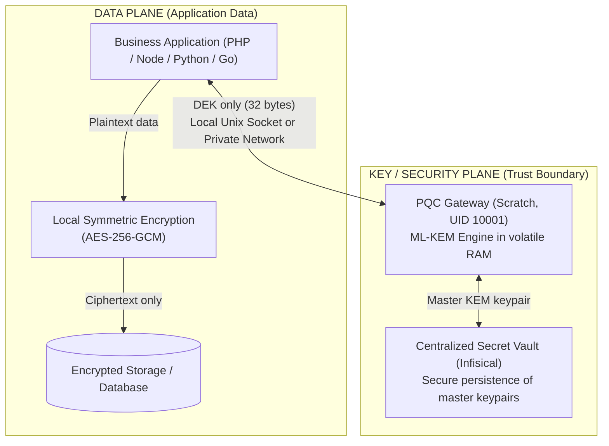
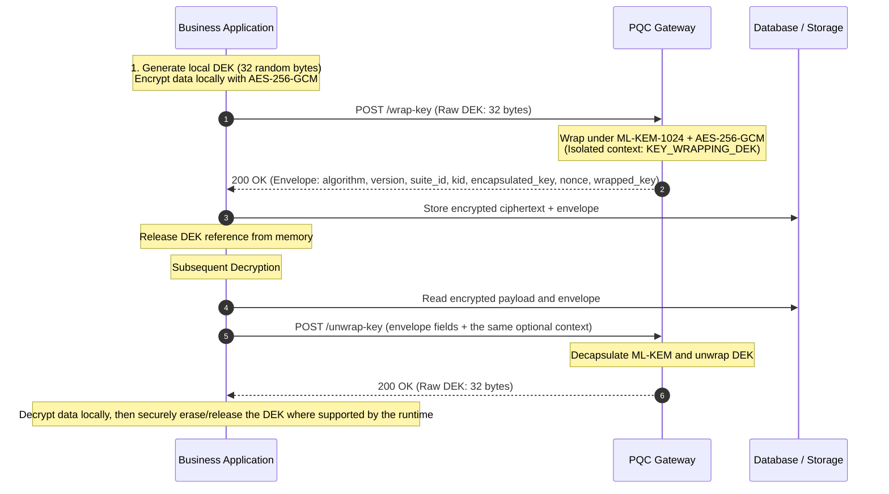

# Post-Quantum Cryptography Gateway (ML-KEM + AES-256-GCM)

[🇬🇧 English](README.md) | [🇫🇷 Français](README.fr.md)

This project provides an autonomous post-quantum encryption and key encapsulation gateway, implementing **ML-KEM** as standardized in **NIST FIPS 203**, and using algorithms aligned with **NSA CNSA 2.0** recommendations.

> [!IMPORTANT]
> **Deployment Context & Trust Boundary**:
> This component is designed exclusively as an internal infrastructure service operating on a **private, isolated, and segmented network** (or via local Unix IPC socket). It is **not intended for direct public exposure to the Internet** without a preceding authentication, authorization, and network filtering layer.

---

## 1. Security Model and Trust Boundary

Understanding the security perimeter is essential prior to deployment:



### Key Threat Model Principles:
1. **Gateway access is a trust boundary**: Any client or container able to communicate with the gateway can issue `/unwrap-key` operations. Restrict access with filesystem permissions (Unix socket, `SOCKET_MODE` at most `0770`, and `SOCKET_ALLOWED_UIDS` to admit only kernel-attested UIDs), with **mTLS** (`TLS_CLIENT_CA_FILE` and `TLS_CLIENT_ALLOWED_NAMES`: a verified, named client certificate is then required on every route except `/health`) or with **bearer tokens** (`AUTH_TOKENS`).
   - **Fail-closed transport**: in production, the service refuses to start on a non-loopback TCP address without TLS, unless `ALLOW_INSECURE_TCP=true` is set explicitly. Outside a container it listens on `127.0.0.1` by default.
2. **Recommended Sidecar Pattern (1 Gateway per Application / SaaS)**: Deploying a dedicated gateway instance per application or tenant reduces cross-consumer blast radius and prevents direct cross-application key access.
3. **Shared Gateway Pattern (Multi-Tenancy)**: If a single gateway instance is shared across multiple applications, authenticate consumers (mTLS, tokens or UIDs) and enable **identity binding** (`BIND_CLIENT_IDENTITY=true`, see §6a): the client identity enters the key derivation of every envelope, which no other client can open. The **encryption context** (see §4b) additionally binds the envelope to a record.

---

## 2. Recommended Architecture: Envelope Encryption (KMS Wrapping)

The primary recommended design pattern for databases, large files, and backups is **Envelope Encryption** using `/wrap-key` and `/unwrap-key`.

### Why this architecture is preferred:
- **Zero large data transmission**: Files of several megabytes or gigabytes never travel to the gateway. Only the 32-byte Data Encryption Key (DEK) is transmitted.
- **Optimal throughput**: Bulk encryption occurs locally in application memory using native AES-256-GCM (leveraging hardware AES acceleration when available).
- **Streamlined key management**: Key-management operations primarily concern compact wrapped DEK envelopes rather than bulk encrypted datasets. Automated master-key versioning and rotation are planned capabilities.
- **Operational Guidance**: Envelope encryption is recommended for large or persistently stored data. Direct encryption remains a supported first-class mode for small payloads and simpler integration patterns.



---

## 3. Gateway Endpoints Overview

| Endpoint | Role | Use Case | Recommendation |
| :--- | :--- | :--- | :--- |
| **`/wrap-key` & `/unwrap-key`** | **Envelope Encryption (KMS)** | Databases, files, backups, long-term archives | ⭐ **Recommended Architecture** |
| `/encrypt` & `/decrypt` | Direct hybrid encryption | Messages and files up to 10 MiB by default, JSON payloads | Secondary / convenience |
| `/kem/encapsulate` & `/kem/decapsulate` | Pure KEM Key Agreement | Post-quantum shared secret establishment | Custom protocols |
| `/generate-key` | KMS Key Generation | Generates a new DEK + its wrapped envelope | Initial session setup |
| `/public-key` | Public Key Distribution | Retrieves active post-quantum public key | Asymmetric pipelines |
| `/health` | Liveness & Readiness probe | Docker healthchecks & orchestrator probes | Monitoring |
| `/metrics` | Prometheus text exposition | Request counters, latency histograms, rate-limit and saturation rejections; subject to authentication (token, mTLS) like every other route | Observability *(opt-out via `METRICS_ENABLED`)* |

---

## 4. Cryptographic Specifications and Alignment

| Algorithm | Reference Standard | Public Key | Private Key (RAM) | Ciphertext (EncapKey) | Security Objective |
| :--- | :--- | :--- | :--- | :--- | :--- |
| **ML-KEM-1024** *(default)* | NIST FIPS 203 | **1568 bytes** | 3168 bytes | **1568 bytes** | NIST Category 5 (Aligned with CNSA 2.0 key establishment recommendations) |
| **ML-KEM-768** | NIST FIPS 203 | 1184 bytes | 2400 bytes | 1088 bytes | NIST Category 3 |
| **DUAL-X25519+ML-KEM-1024** | Classical + PQ Hybrid | 1600 bytes | 3200 bytes | 1600 bytes | Hybrid defense-in-depth / migration strategy |
| **DUAL-X25519+ML-KEM-768** | Classical + PQ Hybrid | 1216 bytes | 2432 bytes | 1120 bytes | Hybrid defense-in-depth (Performance / Security) |

- **CNSA 2.0 Alignment**: The service uses algorithms selected and aligned with CNSA 2.0 recommendations for key establishment (ML-KEM-1024) and symmetric payload protection (AES-256-GCM). *Note: Comprehensive CNSA 2.0 compliance covers broader protocol and digital signature standards (ML-DSA) not included in this microservice.*
- **FIPS 203 Implementation**: The gateway implements ML-KEM as standardized in NIST FIPS 203 using Cloudflare's CIRCL library. *It does not claim an official NIST FIPS 140-3 or CMVP cryptographic module validation.*
- **DUAL Hybrid Constructions**: The DUAL modes (`DUAL-X25519+ML-KEM-768` and `DUAL-X25519+ML-KEM-1024`) are project-defined hybrid constructions combining X25519 and ML-KEM through HKDF-SHA256 with transcript binding. The ML-KEM component conforms to FIPS 203; the complete hybrid construction is not itself a NIST-standardized KEM.
- **Key Management & Ephemeral vs Vault Mode**:
  - When Infisical is enabled, the active keypair is loaded from or stored as a single keypair bundle in the vault (`PQ_KEM_KEYPAIR`).
  - When disabled, the gateway operates with an ephemeral in-memory keypair.
  - **Ephemeral Mode Note**: When Infisical is disabled, a new KEM keypair is generated at each process start. Ciphertexts or wrapped keys produced with a previous process instance cannot be recovered after restart unless the corresponding keypair has been externally preserved.
- **Key Identifier & Rotation**:
  - Every envelope carries a `kid`: `hex(SHA-256("pqc-kid:" ‖ public key))[:16]`, identifying the recipient key. An envelope whose `kid` designates another key is rejected (`422`). `/public-key` returns the active `kid`.
  - Selecting among several retained private keys by `kid` (keyring) is the next roadmap step; today the gateway serves the single active keypair.
- **HKDF Derivation**: HKDF-SHA256 with canonical TLV (Tag-Length-Value) transcripts enforcing domain separation between use cases.

---

## 4b. Envelope Format, Encryption Context & Responses

- **JSON envelope**: `algorithm`, `version` and `suite_id` are required on input; `kid` is optional (envelopes produced by 0.0.x have none and remain decryptable).
- **Encryption context** (equivalent of a KMS *encryption context*): `/encrypt`, `/decrypt`, `/wrap-key`, `/unwrap-key` and `/generate-key` accept an optional `"context"` string (binary routes: `X-Encryption-Context` header, max 4 KiB). It is bound into the HKDF salt and the AES-GCM AAD, so the exact same context is required to decrypt. It is **never returned nor stored** with the envelope: rebuild it from your own data (tenant, record id…). Swapping two records' envelopes then fails with `422`.
- **`/decrypt` response**: exactly one field is set — `plaintext` when the plaintext is valid UTF-8 and its JSON encoding stays close to its size (at most the Base64 size + 4 KiB), `data` (Base64) otherwise. Clients must therefore accept both fields.
- **Per-route body sizes**: `/encrypt` accepts `MAX_PAYLOAD_BYTES`; `/decrypt` accepts `1.5 × MAX_PAYLOAD_BYTES + 64 KiB`, which guarantees that **every ciphertext produced by `/encrypt` can be decrypted**, in JSON or binary, even re-encoded with `\/` escapes (PHP `json_encode`). Every other route (keys, KEM, `GET`) is capped at 64 KiB. A `Content-Length` above the limit is rejected (`413`) before anything is read.
- **Content types**: a body must be declared `application/json` (or `application/octet-stream` on binary routes), otherwise `415`. JSON sent as `text/plain` or from an HTML form is never processed.
- **Strict JSON**: one object per request; every key must match a documented field exactly (case included), once; canonical standard Base64 (RFC 4648 with padding); `/encrypt` requires exactly one of `plaintext` or `data`. Error messages never quote a received value.
- **Binary format** (`application/octet-stream`), big-endian, emitted in V3, V2 still accepted on input:

  ```text
  V3: 'P' 'Q' 0x03 | suite_id (2) | kid (8) | len(encap) (2) | encap | nonce (12) | ciphertext+tag
  V2: 'P' 'Q' 0x02 | suite_id (2) |           len(encap) (2) | encap | nonce (12) | ciphertext+tag
  ```

  Headerless legacy envelopes and `ALLOW_LEGACY_ENVELOPES` were removed in 0.1.0.

---

## 5. Transport Protocols: Unix Domain Socket vs Private TCP Network

| Mode | Parameters | Security Properties | Recommended For |
| :--- | :--- | :--- | :--- |
| **Unix IPC Socket (TCP-Disabled Mode)** | `SOCKET_PATH=/tmp/pq-crypto/pq.sock`<br>`DISABLE_TCP=true`<br>`SOCKET_ALLOWED_UIDS=33` | **Local kernel IPC through a Unix Domain Socket whose filesystem entry resides on an ephemeral tmpfs volume**. Eliminates network transport exposure on the host. | ⭐ **Collocated Sidecar deployments** |
| **Dual Mode (TCP + Socket)** | `PORT=8080`<br>`SOCKET_PATH=/tmp/pq-crypto/pq.sock`<br>`DISABLE_TCP=false` | Concurrent local IPC and private network listening. | Progressive migration / hybrid clients |
| **TCP with mTLS** | `TLS_CERT_FILE`, `TLS_KEY_FILE`<br>`TLS_CLIENT_CA_FILE`<br>`TLS_CLIENT_ALLOWED_NAMES` | TLS 1.3 (hybrid X25519MLKEM768 key exchange first) and a verified client certificate on every route except `/health`, which then only returns a minimal status. Certificates from another CA fail the handshake; a certificate from the right CA whose names (CN, DNS or URI SAN) are not in `TLS_CLIENT_ALLOWED_NAMES` gets `403`. | ⭐ **Multi-server deployments** |
| **TCP with TLS only** | `TLS_CERT_FILE`, `TLS_KEY_FILE` | Encrypted transport, no client authentication (keep network filtering). | Private networks with upstream authentication |
| **Clear-text TCP** | `ALLOW_INSECURE_TCP=true` | DEKs and plaintexts travel unencrypted. Refused in production unless explicitly allowed; a warning is logged. | Loopback or trusted private bridge only |

---

## 6. Container Hardening & Reduced Host Attack Surface

The service enforces strict least-privilege principles to reduce the host attack surface:

- **`FROM scratch` Image**: Autonomous static Go binary (~11 MB), containing no OS distribution, no shell (`/bin/sh`), and no system utilities (`curl`, `wget`).
- **Non-Root User (`UID 10001`)**: Executes under the dedicated `appuser` account (UID/GID 10001), without a shell.
- **Zero Kernel Capabilities (`cap_drop: [ALL]`)**: All elevated Linux capabilities are dropped at container start.
- **Read-Only Root Filesystem (`read_only: true`)**: The root disk is locked against modifications. Ephemeral files and the IPC socket entry point live strictly in an in-memory `tmpfs` volume.
- **No Privilege Escalation (`no-new-privileges: true`)**: Prevents privilege acquisition via SUID executables.
- **Anti-Memory-Dump Hardening**: `PR_SET_DUMPABLE=0` (no `ptrace` or `/proc/<pid>/mem` for unprivileged processes), `RLIMIT_CORE=0` (no core dump) and `PR_SET_NO_NEW_PRIVS=1`, applied at startup on Linux.
- **Automatic memory ceiling**: without `GOMEMLIMIT`, the service targets 85% of the container memory limit (cgroup v2 or v1) so the garbage collector runs before an OOM kill; it logs a warning when `MAX_CONCURRENT_REQUESTS` and `MAX_PAYLOAD_BYTES` can exceed that memory.

---

## 6a. Authentication, Identity and Client Isolation

Three layers that can be combined, described in [SECURITY.md](SECURITY.md) with the attack table:

1. **Transport**: Unix socket (`SOCKET_ALLOWED_UIDS`) or TLS 1.3 with mTLS (`TLS_CLIENT_ALLOWED_NAMES`).
2. **Bearer tokens** (`AUTH_TOKENS`): `Authorization: Bearer <secret>`, verified by digest in constant time.
3. **Identity binding** (`BIND_CLIENT_IDENTITY=true`): the client identity (token, certificate or UID) enters the HKDF salt and the AAD of every envelope, as `IDENTITY:<identity>\x00<client context>`. A client that gained access to the service can only reopen its own envelopes: tenant isolation is cryptographic. The rate limit and concurrency cap are then counted per identity, not per address.

Every operation is logged (`AUDIT_LOG`) with the client identity, the `kid` and the outcome.

## 6b. Secret Memory Hygiene

A plaintext, a data key or a private key only lives in `[]byte` buffers owned by the service and wiped as soon as they are no longer needed:

- **Requests**: the body is read into a pre-sized buffer (with 16 bytes of slack for in-place encryption) that wipes its old copies whenever it has to grow (instead of `io.ReadAll`), then decoded without copies: Base64 and text fields are read straight into wipeable bytes, never into immutable Go strings. The raw body is wiped right after decoding.
- **In-place encryption**: the ciphertext replaces the plaintext in the request buffer (AES-GCM `Seal` in place), and the decrypted plaintext replaces the ciphertext: no intermediate copy.
- **Responses**: small responses are built in a wipeable buffer; above 16 KiB, the ciphertext or plaintext is encoded (Base64 or JSON string) in 48 KiB blocks straight to the connection, with a precomputed `Content-Length` and no response buffer.
- **Cryptographic computation**: the transcript is assembled and hashed on the stack, HKDF-SHA256 runs on the stack (verified against `crypto/hkdf`), the AES key lives in a stack array: 9 allocations per encryption instead of 51. The image is built with `GOEXPERIMENT=runtimesecret`. Every operation (KEM, HKDF, AES-GCM, X25519) runs under `runtime/secret`: registers and stack are erased on return, and the libraries' internal allocations (expanded AES keys, Keccak states, intermediate secrets) are erased as soon as they are freed. Measured cost: negligible now that the `secret.Do` scope barely allocates (31 µs instead of 30 µs for an ML-KEM-768 encryption). A binary built without the experiment logs `secret_erasure_disabled` in production.
- **Infisical**: the private key is only decoded and encoded in wipeable buffers; HTTP redirects are refused (a `307` would resend the body, hence the key, to the designated host). The `client_secret` is read as bytes, removed from the process environment as soon as it is read, and wiped once the engine is built: it is only needed at startup.
- **Measurement** (searching markers in `/proc/<pid>/mem`): after one encryption, decryption, key wrap and key unwrap, 0.1.2 left 5–6 copies of the text and 7–8 of the key; this version leaves at most 1 of the text and 2 of the (Base64) key, and none after a few more requests (0.1.2 still kept 1–2 copies of the key).
- **Swap**: the compose file sets `memswap_limit` to the memory limit, which forbids writing any of the process memory to disk.
- **Hardware AES**: without AES-NI (or ARMv8 extensions), Go's software AES is not constant-time; the service says so at startup (`software_aes`).
- **Known limits**: the remaining copies are the last request or response, inside `net/http`'s internal `bufio` buffers, which are reused and therefore overwritten by later traffic. Kernel and standard-library TLS buffers are not covered either. The encryption context is not a secret.
- **Docker Daemon Isolation (`/var/run/docker.sock`)**: The container does not mount the host Docker socket, possesses no permissions to access it, and operates in an isolated mount namespace.

---

## 7. Client Integration Examples (Envelope KMS Pattern)

### PHP (Envelope Encryption via Unix Socket)
```php
<?php
// 1. Locally encrypt the large document in application memory
$dek = random_bytes(32); // 256-bit local key
$iv = random_bytes(12);
$tag = '';
$ciphertext = openssl_encrypt($documentData, 'aes-256-gcm', $dek, OPENSSL_RAW_DATA, $iv, $tag);

// 2. Gateway wraps ONLY the 32-byte DEK over the local Unix IPC socket
$ch = curl_init('http://localhost/wrap-key');
curl_setopt_array($ch, [
    CURLOPT_UNIX_SOCKET_PATH => '/tmp/pq-crypto/pq.sock',
    CURLOPT_POST           => true,
    CURLOPT_RETURNTRANSFER => true,
    CURLOPT_HTTPHEADER     => ['Content-Type: application/json'],
    CURLOPT_POSTFIELDS     => json_encode(['plaintext_key' => base64_encode($dek)])
]);
$envelope = json_decode(curl_exec($ch), true);
curl_close($ch);
unset($dek); // Release the DEK reference; PHP does not guarantee secure memory zeroization

// 3. Subsequent unwrapping to read the document
$ch = curl_init('http://localhost/unwrap-key');
curl_setopt_array($ch, [
    CURLOPT_UNIX_SOCKET_PATH => '/tmp/pq-crypto/pq.sock',
    CURLOPT_POST           => true,
    CURLOPT_RETURNTRANSFER => true,
    CURLOPT_HTTPHEADER     => ['Content-Type: application/json'],
    CURLOPT_POSTFIELDS     => json_encode([
        'algorithm'        => $envelope['algorithm'],
        'version'          => $envelope['version'],
        'suite_id'         => $envelope['suite_id'],
        'encapsulated_key' => $envelope['encapsulated_key'],
        'nonce'            => $envelope['nonce'],
        'wrapped_key'      => $envelope['wrapped_key']
    ])
]);
$unwrapped = json_decode(curl_exec($ch), true);
curl_close($ch);

$restoredDek = base64_decode($unwrapped['plaintext_key']);
$originalData = openssl_decrypt($ciphertext, 'aes-256-gcm', $restoredDek, OPENSSL_RAW_DATA, $iv, $tag);
```

### PHP (Using the Production Client)
Complete implementation available in [`examples/php/client.php`](examples/php/client.php):
```php
require_once __DIR__ . '/examples/php/client.php';

$pq = new PQCryptoClient('http://127.0.0.1:8080', null, 5, getenv('PQC_TOKEN') ?: null); // token when AUTH_TOKENS is configured

// 1. Wrap local AES-256-GCM DEK with post-quantum ML-KEM
$envelope = $pq->wrapKey($dek);

// 2. Restore DEK whenever decryption is requested
$restoredDek = $pq->unwrapKey($envelope);
```

### Node.js (Using the Production Client)
Complete implementation available in [`examples/node/client.js`](examples/node/client.js):
```javascript
import { PQCryptoClient } from './examples/node/client.js';

const pq = new PQCryptoClient({ baseURL: 'http://127.0.0.1:8080', token: process.env.PQC_TOKEN }); // token when AUTH_TOKENS is configured

// 1. Wrap local 32-byte DEK with post-quantum ML-KEM
const envelope = await pq.wrapKey(dek);

// 2. Restore DEK whenever decryption is needed
const restoredDek = await pq.unwrapKey(envelope);
```

---

## 8. Docker Compose Configuration Variables

The `.env` file provides configuration tuning for the gateway:

| Variable | Default | Description |
| :--- | :--- | :--- |
| `ALGORITHM` | `ML-KEM-1024` | Cryptographic suite: `ML-KEM-1024`, `ML-KEM-768`, `DUAL-X25519+ML-KEM-1024`, `DUAL-X25519+ML-KEM-768`. |
| `ENVIRONMENT` | `production` | Only `development`, `dev`, `test`, `local` and `ci` lift production guards; **any other value (staging, typo, empty) is treated as production**. |
| `MOCK_MODE` | `false` | Mock engine (no confidentiality). Only compiled with `-tags mock`: **the published image cannot run in mock mode**. |
| `HOST_BIND_ADDRESS` | `127.0.0.1` | Host IP address Docker binds published ports to (loopback default). |
| `HOST_PORT` | `8085` | Port published on the host. |
| `LISTEN_ADDRESS` | `127.0.0.1` (image: `0.0.0.0`) | TCP listening address. |
| `TLS_CERT_FILE` / `TLS_KEY_FILE` | *(empty)* | Server certificate and key (PEM): enables TLS on the TCP listener. |
| `TLS_CLIENT_CA_FILE` | *(empty)* | Client CA bundle (PEM): enables mTLS. |
| `ALLOW_INSECURE_TCP` | `false` (compose: `true`) | Allows clear-text TCP outside loopback in production. Trusted private network only. |
| `PORT` / `CONTAINER_PORT` | `8080` | Internal container HTTP listening port. |
| `ACCESS_LOG` | `false` | Access logging per HTTP request (disabled by default for maximum throughput). |
| `RATE_LIMIT_RPS` | `500` | Requests per second per source: authenticated identity (token, certificate, UID) or, failing that, IP address (IPv6 per /64). 0 = disabled. |
| `RATE_LIMIT_BURST` | `1000` | Rate limiter token bucket burst capacity. |
| `MAX_CONCURRENT_REQUESTS` | `16` | Requests processed simultaneously (0 = unbounded); one source may hold at most a quarter. Beyond: `503` + `Retry-After`. |
| `LOG_FORMAT` | `json` | Structured log output: `json` (recommended in production) or `text`. |
| `LOG_LEVEL` | `info` | Log verbosity: `debug`, `info`, `warn`, `error`. |
| `METRICS_ENABLED` | `true` | Exposes `/metrics` in Prometheus text format. Restrict to your monitoring network: the endpoint is unauthenticated. |
| `SOCKET_PATH` | *(empty)* | Local Unix IPC socket path (e.g. `/tmp/pq-crypto/pq.sock`). |
| `SOCKET_MODE` | `0660` | Unix permissions of the IPC socket, owner/group bits only (at most `0770`). Applied at creation. |
| `SOCKET_GID` | `-1` | Group ID for IPC Unix socket (fails closed if set and chown fails). |
| `DISABLE_TCP` | `false` | When `true`, disables TCP network listener entirely (IPC socket only). |
| `TRUSTED_PROXIES` | *(empty)* | Proxies (CIDRs or addresses, comma-separated) whose `X-Forwarded-For` is trusted to identify the client (rate limit, per-source cap). Empty: the connection address always wins. Replaces `TRUST_PROXY`, which let any direct client forge an identity. |
| `TLS_MIN_VERSION` | `1.3` | Minimum TLS version of the TCP listener; `1.2` for older clients. |
| `TLS_CLIENT_ALLOWED_NAMES` | *(empty)* | mTLS: names (CN, DNS or URI SAN) of accepted client certificates. Empty: any certificate from the client CA (warning at startup). |
| `AUTH_TOKENS` | *(empty)* | Accepted bearer tokens, comma-separated `name:secret` (secret ≥ 32 bytes), or `AUTH_TOKENS_FILE`. Required on every route except `/health` (minimal answer). Kept as SHA-256 digests, compared in constant time; removed from the process environment (Go copy and initial `/proc/<pid>/environ` block). |
| `BIND_CLIENT_IDENTITY` | `false` | Binds every envelope to the client identity (token name, certificate name or `uid:<n>`) in the key derivation and AAD: a client can only reopen its own envelopes. Requires an identity source. |
| `AUDIT_LOG` | `true` | One `audit` line per cryptographic operation: operation, client, `kid`, outcome, correlation id. Never any data. |
| `MAX_CONNECTIONS` | `1024` | Concurrent connections accepted per listener; beyond it, accept waits (0 = unlimited). |
| `SOCKET_ALLOWED_UIDS` | *(empty)* | UIDs of processes allowed on the Unix socket, attested by the kernel (`SO_PEERCRED`, Linux); other connections are closed before any read. The UID becomes the identity. |
| `INFISICAL_CA_FILE` | *(empty)* | Authority (PEM) of the Infisical instance; empty: system CAs. The transport requires TLS 1.3. |
| `MAX_PAYLOAD_BYTES` | `10485760` (10 MiB) | Request body ceiling (raise it for larger payloads, together with `MEM_LIMIT`). `/decrypt` accepts 1.5 × this value + 64 KiB (see §4b). Keep `MAX_CONCURRENT_REQUESTS × 4 × MAX_PAYLOAD_BYTES` below `MEM_LIMIT`. |
| `GOMEMLIMIT` | *(85% of the container limit)* | Go garbage-collector target; computed automatically when unset. |
| `READ_TIMEOUT_SECONDS` | `10` | HTTP read timeout (mitigates Slowloris attacks). |
| `WRITE_TIMEOUT_SECONDS`| `10` | HTTP write timeout. |
| `IDLE_TIMEOUT_SECONDS` | `60` | HTTP idle keep-alive timeout. |
| `INFISICAL_ENABLED` | `false` | Enables keypair synchronization with an Infisical secret vault. |
| `INFISICAL_URL` | `https://infisical:8443` | URL for the Infisical instance; **`https://` required in production**. |
| `INFISICAL_SECRET_BUNDLE_NAME` | `PQ_KEM_KEYPAIR` | Secret name for atomic keypair bundle. |
| `INFISICAL_SECRET_PUBKEY_NAME` / `INFISICAL_SECRET_PRIVKEY_NAME` | `PQ_KEM_PUBLIC_KEY` / `PQ_KEM_PRIVATE_KEY` | Secrets of the old split layout, **which is no longer read**: if they exist without a bundle, startup fails instead of generating a new keypair (see CHANGELOG 0.2.0). |
| `NO_NEW_PRIVILEGES` | `true` | Forbids privilege escalation via Linux SUID binaries. |
| `READ_ONLY_ROOTFS` | `true` | Mounts root container filesystem in read-only mode. |
| `TMPFS_MOUNT` | `/tmp:rw,noexec,nosuid,nodev,size=16m` | Volatile in-memory filesystem for ephemeral files. |
| `HEALTHCHECK_INTERVAL` | `10s` | Frequency for `/usr/local/bin/pq-server -healthcheck`. |
| `CPU_LIMIT` / `MEM_LIMIT` | `1.5` / `1G` | Resource ceiling limits. |

---

## 8b. Observability

**Structured logging.** All service output is emitted through `log/slog`. In the default `json` format each
record is a single JSON object, so the correlation identifier is an indexable field rather than a substring
to parse:

```json
{"time":"2026-09-10T19:46:51Z","level":"INFO","msg":"http_request","correlation_id":"a5ce690a63f5...",
 "method":"POST","path":"/wrap-key","status":200,"duration_us":412,"bytes":2104,"remote_addr":"10.0.0.7:52344",
 "client":"billing-app","user_agent":"PQCryptoClient/php"}
```

**Audit log.** With `AUDIT_LOG=true` (default), every cryptographic operation produces an `audit` record:
the operation, the client identity, the source, the key `kid` and the outcome, never the data:

```json
{"time":"2026-09-10T19:46:51Z","level":"INFO","msg":"audit","op":"open:KEY_WRAPPING_DEK","client":"billing-app",
 "source":"10.0.0.7:52344","kid":"4b1d3d82ba3d1718","outcome":"ok","correlation_id":"a5ce690a63f5..."}
```

Every request carries an `X-Correlation-ID` header, honoured from the inbound `X-Correlation-ID` or
`X-Request-ID` when present, generated otherwise. It is propagated to the response, the access log and the
panic records, including on `429`, `503` and `500` responses. A client-supplied identifier is only kept if it
matches `[A-Za-z0-9._:-]{1,128}`; otherwise a fresh one is generated.

**Metrics.** `/metrics` serves the Prometheus text exposition format with no third-party dependency:

| Series | Type | Labels |
| :--- | :--- | :--- |
| `pqc_requests_total` | counter | `path`, `status` |
| `pqc_request_duration_seconds` | histogram | `path` |
| `pqc_rate_limited_total` | counter | — |
| `pqc_overloaded_total` | counter | — |
| `pqc_panics_recovered_total` | counter | — |
| `pqc_uptime_seconds` | gauge | — |
| `pqc_build_info` | gauge | `version`, `algorithm` |

Histogram buckets start at 500 µs: a nominal KEM+DEM operation completes well below the millisecond, so
coarser buckets would collapse the entire latency profile into a single bar.

**Bounded cardinality.** The `path` label only ever carries a route declared by the router. Any other
request path — including probes and scanners — is aggregated under `path="other"`. The series table is
built once at startup and never grows during service, so the size and cost of a scrape are independent of
the traffic received, and a caller cannot turn the exposition endpoint into a memory amplifier. The
instrumentation path itself performs no allocation (immutable route table, atomic counters).

---

## 8c. Performance

End-to-end measurements: full HTTP request through every middleware (`tests/http_bench_test.go`), 0.2.0 and 0.3.0 built identically (`GOEXPERIMENT=runtimesecret`, like the image) and run back to back on the same 4-vCPU VM, median of 5 runs. Absolute values depend on the machine; the ratio is what matters.

| Operation | 0.2.0 | 0.3.0 | Gain |
| :--- | ---: | ---: | ---: |
| `/wrap-key` JSON, 32-byte key | 98 µs | 51 µs | 1.9× |
| `/unwrap-key` JSON | 110 µs | 63 µs | 1.7× |
| `/encrypt` JSON, 1 MiB | 9.4 ms (112 MB/s) | 4.6 ms (230 MB/s) | 2.05× |
| `/decrypt` JSON, 1 MiB | 10.2 ms | 4.7 ms | 2.2× |
| `/encrypt` binary, 1 MiB | 2.0 ms (520 MB/s) | 1.5 ms (690 MB/s) | 1.3× |
| `/decrypt` binary, 1 MiB | 1.6 ms (650 MB/s) | 1.1 ms (925 MB/s) | 1.4× |
| ML-KEM-768 encryption alone | 84 µs, 51 allocations | 32 µs, 9 allocations | 2.7× |
| ML-KEM-768 decryption alone | 90 µs | 39 µs | 2.3× |
| Peak memory, 16 × 10 MiB in parallel (`MAX_CONNECTIONS=4`) | 494 MiB | 137 MiB | 3.6× |

What changed: single-pass strict JSON decoder (no `json.Valid` + `json.Unmarshal`), in-place encryption, streamed responses, transcript and HKDF on the stack, allocation-free security headers and request context, concurrency-cap fast path. The remaining floor on the JSON path is the standard library's Base64 encoding (more than half of the time).

## 9. Quality Assurance, Testing & Roadmap

The codebase undergoes rigorous verification and includes a testing roadmap:
- **ML-KEM Primitive Validation (NIST ACVP KAT)**: The CIRCL ML-KEM implementation used by the gateway is checked against all 180 cases of the pinned NIST ACVP FIPS 203 dataset (75 KeyGen, 75 Encap, 30 Decap), with exact byte matching. Gateway protocol and integration behavior are covered by separate regression and security-invariant tests.
- **Chained Stress Testing**: 2,000 sequential deterministic keygen/encap/decap cycles designed to detect state drift, reproducibility failures, and integration regressions.
- **Deterministic Regression Vectors**: Reproducible tests covering canonical transcripts, HKDF derivation, binary envelopes, and cryptographic domain separation.
- **Security Invariants & Boundary Tests**: Extensive tests verifying binary envelope formats, algorithm falsification rejection, and HKDF domain separation.
- **Race Condition Detection**: Verified with `go test -race` (available via `make test-race` and automated in CI).
- **Mock build tag**: the mock engine is compiled only with `-tags mock`. `make test`, the Dockerfile and CI run the suite both with and without the tag; an untagged test asserts the mock suite is absent from release builds.
- **Dependency Vulnerability Auditing**: Automated dependency vulnerability scanning via `govulncheck` (available via `make vulncheck` and automated in CI). AES-GCM, SHA-256, X25519 and HKDF (HKDF-SHA256 and HMAC computed on the stack, allocation-free, and checked on every test run against the standard library `crypto/hkdf` and `crypto/hmac` on the RFC 5869 vectors and 2,000 random inputs) come from the Go standard library; the only third-party dependency performing cryptography is CIRCL, for ML-KEM.
- **Shipped Artifact Auditing**: CI builds the container image, smoke-tests the running container (`/health`, refusal without token, `/metrics`, correlation header, encrypt/decrypt round trip, `-healthcheck` probe, audit log), extracts the binary that is actually shipped and scans it with `govulncheck -mode=binary`, scans the image with Trivy and publishes an SPDX SBOM. The Dockerfile compiles with its own pinned toolchain, distinct from the one used by the other jobs: only a scan of the extracted artifact covers that gap.
- **Continuous Integration**: GitHub Actions workflow (`.github/workflows/ci.yml`) on every push and pull request, four jobs: tests (`go vet` and `go test -race` in the four build variants: with/without `runtime/secret`, with/without `mock`), fuzzing (strict JSON differential against `encoding/json`, JSON strings, binary envelopes), security (`govulncheck`, `gosec`, `gofmt`), image (build, container smoke test, binary scan, Trivy, SBOM).
- **Roadmap**:
  - Keyring: retain previous private keys and select them by `kid` (automated rotation).
  - Image and SBOM signing (cosign) and provenance attestation (SLSA).
  - Metrics enrichment: per-suite and per-envelope-version counters, aligned with the key rotation lifecycle.

### Verification Evidence & Test Execution (`go test -v`)

```text
=== RUN   TestKAT_NIST_FIPS203_KeyGen
    ✅ NIST FIPS 203 KeyGen [ML-KEM-512]:  25/25 vectors PASS (exact bit-match)
    ✅ NIST FIPS 203 KeyGen [ML-KEM-768]:  25/25 vectors PASS (exact bit-match)
    ✅ NIST FIPS 203 KeyGen [ML-KEM-1024]: 25/25 vectors PASS (exact bit-match)
    Total KeyGen NIST FIPS 203 vectors: 75/75 PASS
--- PASS: TestKAT_NIST_FIPS203_KeyGen

=== RUN   TestKAT_NIST_FIPS203_EncapDecap
    ✅ NIST FIPS 203 Encap AFT [ML-KEM-512]:  25/25 vectors PASS
    ✅ NIST FIPS 203 Encap AFT [ML-KEM-768]:  25/25 vectors PASS
    ✅ NIST FIPS 203 Encap AFT [ML-KEM-1024]: 25/25 vectors PASS
    ✅ NIST FIPS 203 Decap VAL [ML-KEM-512]:  10/10 vectors PASS
    ✅ NIST FIPS 203 Decap VAL [ML-KEM-768]:  10/10 vectors PASS
    ✅ NIST FIPS 203 Decap VAL [ML-KEM-1024]: 10/10 vectors PASS
    Total Encap/Decap NIST FIPS 203 vectors: 105/105 PASS
--- PASS: TestKAT_NIST_FIPS203_EncapDecap

=== RUN   TestKAT_NIST_FIPS203_MonteCarlo_StressTest
    ✅ Monte-Carlo [ML-KEM-768]:  1,000 chained cycles PASS (Accumulator: b27f9cc4...)
    ✅ Monte-Carlo [ML-KEM-1024]: 1,000 chained cycles PASS (Accumulator: 2b13db7c...)
--- PASS: TestKAT_NIST_FIPS203_MonteCarlo_StressTest

PASS (All unit, regression, security invariant, and KAT suites passing)
```

---

## 10. Disclaimer & Non-Certification Notice

> [!CAUTION]
> **Project Status & Absence of Formal Certification**:
> - This software is a source-available project designed to explore and integrate post-quantum cryptography within private architectures.
> - **This software has NOT undergone a formal, independent security audit by an accredited third-party testing laboratory.**
> - **This component is NOT certified under NIST FIPS 140-3 and has NOT been validated by the Cryptographic Module Validation Program (CMVP).**
> - References to "FIPS 203" or "CNSA 2.0" denote the **underlying mathematical algorithms** and specifications implemented, not an official government or regulatory certification.
> - For critical production environments, integrators must perform their own threat modeling and risk assessment, and enforce defense-in-depth isolation measures.

---

## 11. License

Released under the [Business Source License 1.1](LICENSE) (SPDX: `BUSL-1.1`) — Copyright (c) 2026 fdecourt.

The source code is public, but this is **not** an open-source license. In short:

| Use | Allowed |
|-----|---------|
| Read, audit, copy, modify, redistribute, non-production use | Yes |
| Production use for the **internal operations** of your organization | Yes (Additional Use Grant) |
| Offering the gateway, or a service exposing it, to third parties (hosted, managed, embedded, white-label) | No — requires a commercial license |
| Selling, sublicensing or distributing it for a fee | No — requires a commercial license |

On the **Change Date (2030-09-11)**, this version automatically becomes available under the **Apache License 2.0**. The [LICENSE](LICENSE) file is authoritative; this table is only a summary. For a commercial license, contact the Licensor through [github.com/fdecourt](https://github.com/fdecourt).

The license is independent of the disclaimer above: the absence of formal certification remains in force whatever the license permits.

### Third-Party Licenses

The components shipped with the service keep their own licenses. Their full texts and notices are in [THIRD_PARTY_LICENSES](THIRD_PARTY_LICENSES), which is also embedded in the container image at `/THIRD_PARTY_LICENSES`.

| Component | License | Shipped as |
|-----------|---------|------------|
| Go standard library & runtime | BSD-3-Clause | compiled into `pq-server` |
| `golang.org/x/sys` | BSD-3-Clause | compiled into `pq-server` |
| `golang.org/x/time` | BSD-3-Clause | compiled into `pq-server` |
| `github.com/cloudflare/circl` (ML-KEM) | BSD-3-Clause | compiled into `pq-server` |
| Mozilla CA certificate bundle (Alpine `ca-certificates-bundle`) | MPL-2.0 AND MIT | `/etc/ssl/certs/ca-certificates.crt` in the image |
